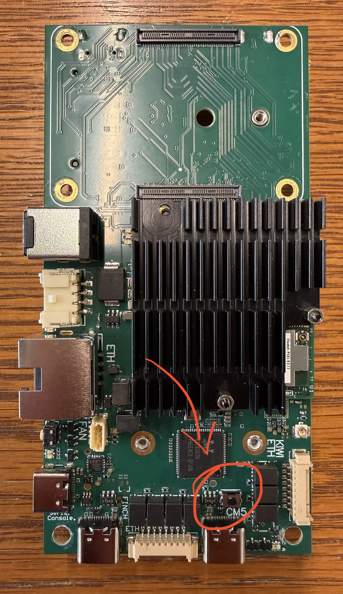

# MAVLink to NMEA TCP Bridge

A simple server for use in converting MAVLink GPS data from an ArduPilot flight computer over serial and broadcasting 
ASCII NMEA-0183 over TCP. This server has been created with Rajant Breadcrumbs in mind, although other clients can use 
it as well. The TCP listener is intentionally left without authorization and encryption, since BreadCrumbs do not 
support authentication with a TCP/IP server. Ensure the server runs on an isolated network for security purposes.

The server emits `$GPGGA` and `$GPVTG` once per output interval. For reference, `$GPGGA` provides GPS-fix information, 
while `$GPVTG` provides direction and speed.

The following guide targets a Rajant DX-5 combo board with a Raspberry Pi Compute Module 5 running Ubuntu Server; 
however, the server should work on any modern Linux distribution as long as the listed dependencies are satisfied. 
The server was also tested on Fedora Linux 44 with no issues.

## (Optional) Flashing RPi CM5 module with onboard storage

*Note: unless you supply additional power to the board, flashing the image with an active cooling fan connected will 
cause the Pi to not be supplied with enough power! Disconnect any active cooling fan and any other accessories that 
require power before proceeding with the flashing process.*

If the Compute Module 5 has not yet been flashed, proceed with the following steps to install Ubuntu Server LTS.
### Power on RPi CM5 into boot mode
Connect a USB-C cable to the computer you want to flash the image from. Orient the DX-5 as shown in the image, then 
press and hold the circled button. Plug the cable into the USB-C port directly beside of the button, and you should 
see the device connect into boot mode. You can now release the button and proceed.



### Flashing Process
Follow the instructions on the official [RPIBOOT repository](https://github.com/raspberrypi/usbboot) to install the utility onto your system (Windows, 
macOS, Linux). Launch the application through the command line or Start menu, then wait until instructed to close the 
window.

Next, follow the instructions on the official [Raspberry Pi software page](https://www.raspberrypi.com/software/) to download and install Raspberry Pi 
Imager. 

Select Raspberry Pi 5:


Select an operating system. For Ubuntu Server, scroll down until you see other general-purpose operating systems:


During the setup process, ensure you enable SSH so you can use it during the installation process.

## Setup Static IP

Since BreadCrumbs typically exist on 10.x.x.x IP address range, the CM5 needs to be configured to use a static 
10.x.x.x IP.

Identify the network interface to be used:
```shell
ip link # you will likely use eth0
```

Locate and edit Netplan configuration:
```shell
ls /etc/netplan

sudo vim /etc/netplan/<REPLACE WITH: config file name>
```

Modify accordingly:
```yaml
network:
  version: 2
  ethernets:
    eth0:
      optional: true
      dhcp4: true # leave enabled until you've downloaded all dependencies
      addresses:
        - 10.0.0.123/8 # user preference
```

Then apply:
```shell
sudo netplan apply
```

Now you should be able SSH into the Pi with your newly created static IP from any device on the BreadCrumb network.

## Install

If you're currently on an isolated network, you will need to temporarily connect the Pi to the greater internet for the 
next section.

Install all system packages needed to build Python dependencies, create virtual environments, run tests, and diagnose 
networking:
```shell
sudo apt update

sudo apt install -y git ca-certificates python3 python3-venv python3-pip build-essential rsync netcat-openbsd iproute2 lsof
```

Clone the repository and install it within an isolated environment:
```shell
git clone <REPLACE WITH: repository URL>
cd /mavlink-nmea-bridge

python3 -m venv .venv # create virtual environment
. .venv/bin/activate # activate virtual environment
python -m pip install --upgrade pip
python -m pip install -e '.[test]'
```

Verify installation:
```shell
python -m pytest
python -m mavlink_nmea_bridge --help
```

If the system restarts, or you start a new session, you will need to reactivate the virtual environment before you can 
run the program again. Recall that you can activate it using
```shell
. .venv/bin/activate # activate virtual environment
```

To make getting back into the virtual environment easier, you can create an alias.
```shell
alias activate='. ./venv/bin/activate'
```

## Connect and configure MAVLink

Identify the serial device of the flight computer. Since the device name can change after being disconnected, always 
use the permanent device path under `/dev/serial/by-id` rather than `/dev/ttyACM0`. **Using a non-permanent path risks 
losing GPS fix until next restart. You may lose GPS fix for the duration of your flight!**

Identify the path of your flight controller and take note of it (it is needed later):
```shell
ls -l /dev/serial/by-id/ # use in production (permanent path)
ls -l /dev/ttyACM* 2>/dev/null # only for testing (temporary path)
```
You will likely see two serial connections for the flight computer. Use the first by default; if that one does not work, 
try the other.

To access a serial device, you will need to add your user to the `dialout` group. Add yourself to this group with:
```shell
sudo usermod -a -G dialout $USER
```

Log out and back in or restart after having added the group.

By default, the Ubuntu Server image will likely come with ModemManager installed. To avoid serial conflicts, remove it:
```shell
sudo apt-get remove modemmanager -y
sudo apt install libfuse2 -y
sudo apt install libxcb-xinerama0 libxkbcommon-x11-0 libxcb-cursor-dev -y
```

Provided in the repository root is an example config file. Rename it to `config.toml` and make changes as needed. At 
minimum, provide the path of your device identified earlier, the baud rate of the flight controller, and your preferred 
TCP port. Other network settings, such as input and output rate, can be configured there as well.
```shell
mv config.example.toml config.toml # rename to use
```

## Configure BreadCrumb

Before proceeding, ensure your Rajant BreadCrumb is configured to listen to the server. Using BC|Commander, log in to 
the BreadCrumb using your login credentials. Right-click the BreadCrumb from the BreadCrumb Table tab. Click Configure; 
you should be in the General tab by default. Scroll down until you see the 'External GPS' settings. Change the following 
settings as specified:

- GPS Device -> TCP/IP
- External GPS IP → IP address of the Raspberry Pi (identify with `ip a` on Pi)
- External GPS TCP port → the port specified in the config file you created
- Timeout before device is considered hung → your preference (use 10000 for now)

## Run manually

Before setting up as a service, make sure all settings are configured properly.

Use the configuration file:
```shell
python -m mavlink_nmea_bridge --config config.toml
```

Or specify options directly:
```shell
python -m mavlink_nmea_bridge \
  --mavlink-endpoint /dev/serial/by-id/<flight-controller> \
  --baud 115200 --position-source GPS_RAW_INT \
  --bind-address 0.0.0.0 --tcp-port 10110 --output-rate 1
```

If you don't have access to a flight controller yet:
```shell
python -m mavlink_nmea_bridge.synthetic \
  --latitude 40.1234567 --longitude -75.1234567 \
  --altitude 120.5 --tcp-port 10110
```

## Setup as a systemd service

*Before proceeding, make sure you have read all instructions above!*

The supplied unit expects the application at `/opt/mavlink-nmea-bridge` and the configuration at 
`/etc/mavlink-nmea-bridge/config.toml`. From the repository root, install a restricted service account and copy the 
checkout:
```shell
sudo useradd --system --home /opt/mavlink-nmea-bridge --shell /usr/sbin/nologin mavlink-bridge

sudo usermod -aG dialout mavlink-bridge

sudo install -d -o mavlink-bridge -g mavlink-bridge /opt/mavlink-nmea-bridge

sudo rsync -a --exclude='.venv' --exclude='__pycache__' ./ /opt/mavlink-nmea-bridge/

sudo chown -R mavlink-bridge:mavlink-bridge /opt/mavlink-nmea-bridge

sudo -u mavlink-bridge python3 -m venv /opt/mavlink-nmea-bridge/.venv

sudo -u mavlink-bridge /opt/mavlink-nmea-bridge/.venv/bin/python -m pip install --upgrade pip

sudo -u mavlink-bridge /opt/mavlink-nmea-bridge/.venv/bin/python -m pip install /opt/mavlink-nmea-bridge

sudo install -d -o root -g mavlink-bridge -m 0750 /etc/mavlink-nmea-bridge

sudo install -o root -g mavlink-bridge -m 0640 config.example.toml /etc/mavlink-nmea-bridge/config.toml

sudo cp ~/mavlink-nmea-bridge/config.toml /etc/mavlink-nmea-bridge/config.toml

sudo install -o root -g root -m 0644 deploy/mavlink-nmea-bridge.env.example /etc/default/mavlink-nmea-bridge
  
sudo install -o root -g root -m 0644 deploy/mavlink-nmea-bridge.service /etc/systemd/system/mavlink-nmea-bridge.service
```

The `useradd` command is for a new installation. If the account already exists, use this instead:
```shell
sudo usermod --home /opt/mavlink-nmea-bridge --shell /usr/sbin/nologin mavlink-bridge
```

Edit the installed config file before starting the service. You can use the same settings you set up earlier.

Enable it and inspect the first startup:
```shell
sudo systemctl daemon-reload

sudo systemctl enable --now mavlink-nmea-bridge

sudo systemctl status mavlink-nmea-bridge

sudo journalctl -u mavlink-nmea-bridge -f
```

The unit waits for network readiness, restarts after failures, runs without root, and logs to journald. Common startup 
issues are a wrong serial endpoint, serial ownership by another process, missing `dialout` access, a heartbeat timeout, 
or TCP port 10110 already being in use.

When updating an existing deployment, copy the new checkout, reinstall the package, review the configuration, and 
restart:
```shell
sudo rsync -a --exclude='.venv' --exclude='__pycache__' ./ /opt/mavlink-nmea-bridge/

sudo chown -R mavlink-bridge:mavlink-bridge /opt/mavlink-nmea-bridge

sudo -u mavlink-bridge /opt/mavlink-nmea-bridge/.venv/bin/python -m pip install /opt/mavlink-nmea-bridge

sudo systemctl restart mavlink-nmea-bridge
```

## Development

Run the test suite from an activated virtual environment:
```bash
python -m pytest
```
